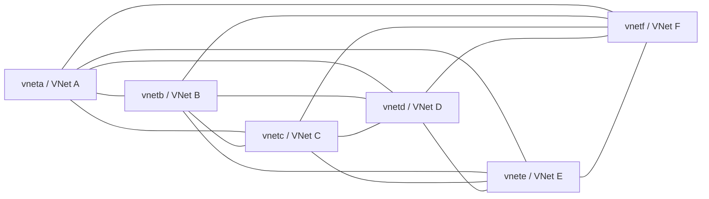
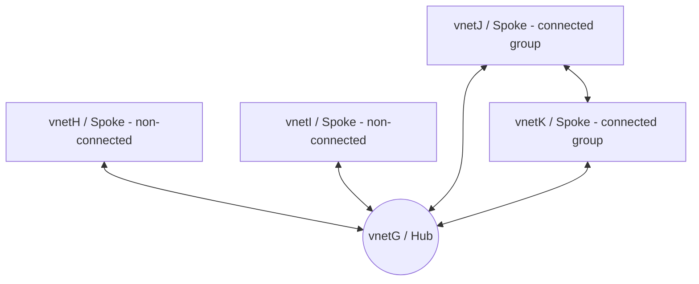
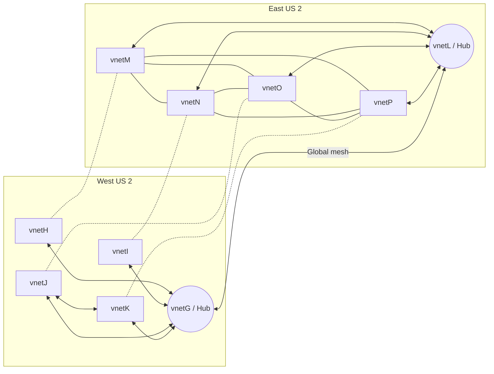

# Lab: Azure Virtual Network Manager


A hands-on Azure Virtual Network Manager (AVNM) lab for building mesh, hub-and-spoke, and hybrid global mesh connectivity topologies.

## Table of Contents

- [🎯 Lab Objectives](#-lab-objectives)
- [🗺️ Topologies](#️-topologies)
- [📋 Prerequisites](#-prerequisites)
- [⚙️ Parameters](#️-parameters)
- [🚀 Quick Start](#-quick-start)
- [📜 Step-by-step commands](#-step-by-step-commands)
- [✅ Validation](#-validation)
- [🧹 Cleanup](#-cleanup)
- [💡 Key Takeaways](#-key-takeaways)
- [📚 References](#-references)
- [📄 License](#-license)

## Introduction

AVNM in a nutshell is the ability to quickly mangage networks at scale within a tenant or cross tenant. It gives you the ability to deploy, configure, group and manage networks at a thousand foot view. From there, you can tune the networks at a more granular view, and segment them based on your requirements. At the time of this writing, only certain regions are available for AVNM. The Powershell commands are also not complete the time fo this lab. Thus, this lab has been doing in CLI. More info and public article can be found here: https://docs.microsoft.com/en-us/azure/virtual-network-manager/overview

## Goals

The goal of this lab is to step through some of the common configuration scenarios that AVNM provides and see how that affects not only the topology behavior, and explore how that changes routing and connectivty.This Microhack will continue to be updated as more scenarios become available. The username for all vms is azureuser and passowrd is MyP@SSword123! The lab does not cover enabling serial console to test connectivity between VMs.  We will start off with stepping through three configuration scenarios:

1. Mesh Configuration -single region
2. Hub+Spoke Configuration and seperating that out with connected groups -single region
3. Hub+Spoke Global Mesh Configuration -multi region

## 🎯 Lab Objectives

Explore three Azure Virtual Network Manager connectivity scenarios:

1. **Mesh** — VNets A-F connected through a direct mesh in one region.
2. **Hub and Spoke** — hub VNet G with spokes H/I using hub transit only and spokes J/K in a directly connected group.
3. **Hub and Spoke + Global Mesh** — the hub-and-spoke design extended across regions with a global mesh configuration.

## 🗺️ Topologies

### Mesh Configuration




### Hub and Spoke Configuration




### Hub and Spoke + Global Mesh




## 📋 Prerequisites

- Azure CLI **2.50 or later**
- Azure Virtual Network Manager CLI extension:

  ```bash
  az extension add --name virtual-network-manager
  ```

- An Azure subscription where you can create VNets, VMs, peerings, and Network Manager resources
- Estimated cost: **~$5/day** while VMs and networking resources are running
- Run `az login` before executing scripts

## ⚙️ Parameters

| Parameter | Default | Description |
| --- | --- | --- |
| `RG` | `avnm-lab-microhack` | Resource group used by all scenarios |
| `LOC` | `westus2` | Primary region for mesh and hub-and-spoke scenarios |
| `LOC2` | `eastus2` | Secondary region for global mesh scenario |
| `AVNM_NAME` | `myavnm` | Azure Virtual Network Manager name |
| `AVNM_GROUP` | `myavnmgroup` | Mesh network group name |
| `VM_SIZE` | `Standard_D2_v2` | VM size used for test VMs |
| `USERNAME` | `azureuser` | VM admin username |
| `PASSWORD` | `MyP@SSword123!` | Lab VM password; override for real usage |

## 🚀 Quick Start

```bash
az login
az extension add --name virtual-network-manager
```

Run the scenarios independently or in sequence:

```bash
# 1. Mesh: vneta-vnetf
bash scripts/01-mesh.sh

# 2. Hub and spoke: vnetG-vnetK
bash scripts/02-hub-and-spoke.sh

# 3. Hub and spoke + global mesh: vnetG-vnetP across West US 2 and East US 2
bash scripts/03-hub-spoke-global-mesh.sh
```

## 📜 Step-by-step commands

The original lab commands are preserved below verbatim in collapsible sections.

<details>
<summary><strong>Mesh Configuration original commands</strong></summary>

## Commands

```bash
#Parameters
rg=avnm-lab-microhack
loc=westus2
avnmname=myavnm
avnmnetgroup=myavnmgroup
subid=$(az account show --query 'id' -o tsv)
vmsize=Standard_D2_v2
username=azureuser
password="MyP@SSword123!"

#List current default subscription you want to use for AVNM
az account show --query id --output tsv

#Create AVNM Resource Group
az group create -n $rg -l $loc --output none

#Create the AVNM instance
az network manager create --name $avnmname \
    --location $loc \
    --description "Network Manager for AVNM Microhack" \
    --display-name "myavnm" \
    --scope-accesses "SecurityAdmin" "Connectivity" \
    --network-manager-scopes subscriptions="/subscriptions/$subid" \
    --resource-group $rg \
    --output none
    
#Create Network Group for AVNM
az network manager group create --name $avnmnetgroup \
    --network-manager-name $avnmname \
    --description "AVNM Microhack Network Group" \
    --display-name $avnmnetgroup \
    --member-type "Microsoft.Network/virtualNetworks" \
    --resource-group $rg \
    --output none
   
#Create the VNETs for the network group 
az network vnet create --address-prefixes 172.16.0.0/24 -n vneta -g $rg -l $loc --subnet-name default --subnet-prefixes 172.16.0.0/27 --output none
az network vnet create --address-prefixes 172.16.1.0/24 -n vnetb -g $rg -l $loc --subnet-name default --subnet-prefixes 172.16.1.0/27 --output none
az network vnet create --address-prefixes 172.16.2.0/24 -n vnetc -g $rg -l $loc --subnet-name default --subnet-prefixes 172.16.2.0/27 --output none
az network vnet create --address-prefixes 172.16.3.0/24 -n vnetd -g $rg -l $loc --subnet-name default --subnet-prefixes 172.16.3.0/27 --output none
az network vnet create --address-prefixes 172.16.4.0/24 -n vnete -g $rg -l $loc --subnet-name default --subnet-prefixes 172.16.4.0/27 --output none
az network vnet create --address-prefixes 172.16.5.0/24 -n vnetf -g $rg -l $loc --subnet-name default --subnet-prefixes 172.16.5.0/27 --output none   

#Add the VNETs statically to the network group. For simplicty, repeat this for the other 5 VNETs and replace the variables for each vnet
vneta=$(az network vnet show -g $rg -n vneta --query id -o tsv) #Do the same for vnetb-vnetf, so that all six vnets are added statically 
az network manager group static-member create --network-group-name $avnmnetgroup \
    --network-manager-name $avnmname \
    --resource-group $rg \
    --static-member-name "vneta" \
    --resource-id=$vneta \
    --output none
    
#Create the configuration for the network group
netgroup=$(az network manager group show --network-group-name $avnmnetgroup --network-manager-name $avnmname --resource-group $rg --query 'id' -o tsv)
az network manager connect-config create --configuration-name "Meshconnectivityconfig" \
    --description "Mesh config for AVNM Microhack" \
    --applies-to-groups group-Connectivity=DirectlyConnected network-group-id=$netgroup
    --connectivity-topology "Mesh" \
    --display-name "Mesh Connectivity" \
    --network-manager-name $avnmname \
    --resource-group $rg \
    --output none
    
#Apply the configuration config
#Kudos to Bruce Cosden and Daniel Mauser. At this time, CLI commands not available so REST API call needed to apply configuration in CLI
config=$(az network manager connect-config show --configuration-name 'Meshconnectivityconfig' -g $rg -n $avnmname --query 'id' -o tsv)
subid=$(az account show --query 'id' -o tsv)
url='https://management.azure.com/subscriptions/'$subid'/resourceGroups/'$rg'/providers/Microsoft.Network/networkManagers/'$avnmname'/commit?api-version=2021-02-01-preview'
json='{
  "targetLocations": [
    "'$loc'"
  ],
  "configurationIds": [
    "'$config'"
  ],
  "commitType": "Connectivity"
}'

az rest --method POST \
    --url $url \
    --body "$json" \
    --output none
    
#Create the VMs in each VNET
#Once created enable serial console on each VM to test connectivity between each.

az vm create -n vnetaVM  -g $rg --image ubuntults --public-ip-sku Standard --size $vmsize -l $loc --subnet default --vnet-name vneta --admin-username $username --admin-password $password --no-wait
az vm create -n vnetbVM  -g $rg --image ubuntults --public-ip-sku Standard --size $vmsize -l $loc --subnet default --vnet-name vnetb --admin-username $username --admin-password $password --no-wait
az vm create -n vnetcVM  -g $rg --image ubuntults --public-ip-sku Standard --size $vmsize -l $loc --subnet default --vnet-name vnetc --admin-username $username --admin-password $password --no-wait
az vm create -n vnetdVM  -g $rg --image ubuntults --public-ip-sku Standard --size $vmsize -l $loc --subnet default --vnet-name vnetd --admin-username $username --admin-password $password --no-wait
az vm create -n vneteVM  -g $rg --image ubuntults --public-ip-sku Standard --size $vmsize -l $loc --subnet default --vnet-name vnete --admin-username $username --admin-password $password --no-wait 
az vm create -n vnetfVM  -g $rg --image ubuntults --public-ip-sku Standard --size $vmsize -l $loc --subnet default --vnet-name vnetf --admin-username $username --admin-password $password --no-wait

#Check the effective routes on the NIC to confirm next HOP via CLI or UI. Replace with your VM nic name!
az network nic show-effective-route-table -n "vnetaVMVMNic" -g $rg
{
      "addressPrefix": [
        "172.16.5.0/24",
        "172.16.4.0/24",
        "172.16.3.0/24",
        "172.16.2.0/24",
        "172.16.1.0/24"
      ],
      "destinationServiceTags": [],
      "disableBgpRoutePropagation": false,
      "hasBgpOverride": false,
      "name": null,
      "nextHopIpAddress": [],
      "nextHopType": "ConnectedGroup",
      "source": "Default",
      "state": "Active",
      "tagMap": {}
    },
#Notice the next HOP type for our destination VNETs is "ConnectedGroup"

#Check to see if there are any VNET Peerings for our AVNM Vnets
az network vnet peering list -g --vnet-name vneta
# The value will be null

#Finally see that you can ping from say vneta to vnetb and from vneta to vnetc direcly from serial console

azureuser@vnetaVM:~$ ping 172.16.1.4
PING 172.16.1.4 (172.16.1.4) 56(84) bytes of data.
64 bytes from 172.16.1.4: icmp_seq=1 ttl=64 time=2.65 ms
64 bytes from 172.16.1.4: icmp_seq=2 ttl=64 time=1.01 ms
64 bytes from 172.16.1.4: icmp_seq=3 ttl=64 time=1.00 ms
64 bytes from 172.16.1.4: icmp_seq=4 ttl=64 time=1.59 ms
^C
--- 172.16.1.4 ping statistics ---
4 packets transmitted, 4 received, 0% packet loss, time 3004ms
rtt min/avg/max/mdev = 1.008/1.569/2.655/0.671 ms
azureuser@vnetaVM:~$ ping 172.16.2.4
PING 172.16.2.4 (172.16.2.4) 56(84) bytes of data.
64 bytes from 172.16.2.4: icmp_seq=1 ttl=64 time=2.53 ms
64 bytes from 172.16.2.4: icmp_seq=2 ttl=64 time=0.955 ms
64 bytes from 172.16.2.4: icmp_seq=3 ttl=64 time=1.07 ms
64 bytes from 172.16.2.4: icmp_seq=4 ttl=64 time=0.953 ms
```

</details>

<details>
<summary><strong>Hub and Spoke Configuration original commands</strong></summary>

## Commmands
This section assumes you kept the resource group and AVNM instance previously from Mesh configuration. If you deleted, re-create those two services again. We will start off with creating the new network groups for Hub+Spoke for "directly connected" and bi directional peering. Then, we will add our new VNETs in question to each network group, followed by creating the configurations and applying the configuration. Finally, we will create the new VMs and test connectivity within the hub and spoke for directly connected and bi directional peered VMs and check the next hops.

```bash
#Pasting same paramaters again from above just in case
rg=avnm-lab-microhack
loc=westus2
avnmname=myavnm
avnmnetgroup=myavnmgroup
vmsize=Standard_D2_v2
username=azureuser
password="MyP@SSword123!"

#Create the network manager in Hub+Spoke for connected group, aka connected mesh
az network manager group create --name "hubspokedirect" \
    --network-manager-name $avnmname \
    --description "network group for direct connect" \
    --display-name "hubspokedirect" \
    --member-type "Microsoft.Network/virtualNetworks" \
    --resource-group $rg \
    --output none
    
#Create the network manager in Hub+Spoke for bi-directional peering only
az network manager group create --name "hubspoke" \
    --network-manager-name $avnmname \
    --description "network group for hub & spoke" \
    --display-name "hubspoke" \
    --member-type "Microsoft.Network/virtualNetworks" \
    --resource-group $rg \
    --output none
    
#Create the vNets for each
az network vnet create --address-prefixes 172.16.6.0/24 -n vnetG -g $rg -l $loc --subnet-name default --subnet-prefixes 172.16.6.0/27 --output none
az network vnet create --address-prefixes 172.16.7.0/24 -n vnetH -g $rg -l $loc --subnet-name default --subnet-prefixes 172.16.7.0/27 --output none
az network vnet create --address-prefixes 172.16.8.0/24 -n vnetI -g $rg -l $loc --subnet-name default --subnet-prefixes 172.16.8.0/27 --output none
az network vnet create --address-prefixes 172.16.9.0/24 -n vnetJ -g $rg -l $loc --subnet-name default --subnet-prefixes 172.16.9.0/27 --output none
az network vnet create --address-prefixes 172.16.10.0/24 -n vnetK -g $rg -l $loc --subnet-name default --subnet-prefixes 172.16.10.0/27 --output none

#Add the static vNETs for bi-directional peering and direct connect (mesh) for Hub+Spoke

#For hub+Spoke
vnetH=$(az network vnet show -g $rg -n vnetH --query id -o tsv) #repeat same steps for vnetI
az network manager group static-member create --network-group-name hubspoke \
    --network-manager-name $avnmname \
    --resource-group $rg \
    --static-member-name "vnetH" \
    --resource-id=$vnetH \
    --output none
    
#For direct peering
vnetJ=$(az network vnet show -g $rg -n vnetJ --query id -o tsv) #repeat same steps for vnetK
az network manager group static-member create --network-group-name "hubspokedirect" \
    --network-manager-name $avnmname \
    --resource-group $rg \
    --static-member-name "vnetJ" \
    --resource-id=$vnetJ \
    --output none
    
#Create the configs for each one for hub+Spoke and the other for Hub+Spoke with direct peering
hubVnet=$(az network vnet show -g $rg -n vnetG --query 'id' -o tsv)
groupid=$(az network manager group show --network-group-name "hubspokedirect" --network-manager-name $avnmname --resource-group $rg --query 'id' -o tsv)
az network manager connect-config create --configuration-name "HubSpokeConnectivityConfig" \
    --description "avnm microhack hub and spoke direct" \
    --applies-to-groups group-Connectivity=DirectlyConnected network-group-id=$groupid
    --connectivity-topology "HubAndSpoke" \
    --display-name "microhack hub and spoke direct" \
    --hub resource-id=$hubVnet resource-type="Microsoft.Network/virtualNetworks" \
    --network-manager-name $avnmname \
    --resource-group $rg \
    --output none
    
hubVnet=$(az network vnet show -g $rg -n vnetG --query 'id' -o tsv)
groupid=$(az network manager group show --network-group-name "hubspoke" --network-manager-name $avnmname --resource-group $rg --query 'id' -o tsv)
az network manager connect-config create --configuration-name "HubSpokeConnectivityConfig-nondirect" \
    --description "avnm microhack hub and spoke" \
    --applies-to-groups group network-group-id=$groupid 
    --connectivity-topology "HubAndSpoke" \
    --display-name "microhack hub and spoke" \
    --hub resource-id=$hubVnet resource-type="Microsoft.Network/virtualNetworks" \
    --network-manager-name $avnmname \
    --resource-group $rg \
    --output none
    
#Apply the config, referencing both config groups
conf=$(az network manager connect-config show --configuration-name 'HubSpokeConnectivityConfig' -g $rg -n $avnmname --query 'id' -o tsv)
confnondirect=$(az network manager connect-config show --configuration-name 'HubSpokeConnectivityConfig-nondirect' -g $rg -n $avnmname --query 'id' -o tsv)
subid=$(az account show --query 'id' -o tsv)
url='https://management.azure.com/subscriptions/'$subid'/resourceGroups/'$rg'/providers/Microsoft.Network/networkManagers/'$avnmname'/commit?api-version=2021-02-01-preview'
json='{
  "targetLocations": [
    "'$loc'"
  ],
  "configurationIds": [
    "'$conf'",
    "'$confnondirect'"
  ],
  "commitType": "Connectivity"
}'

az rest --method POST \
    --url $url \
    --body "$json" \
    --output none
    

#Create the VMs in the vNETS for testing
az vm create -n vnetGVM  -g $rg --image ubuntults --public-ip-sku Standard --size $vmsize -l $loc --subnet default --vnet-name vnetG --admin-username $username --admin-password $password --no-wait
az vm create -n vnetHVM  -g $rg --image ubuntults --public-ip-sku Standard --size $vmsize -l $loc --subnet default --vnet-name vnetH --admin-username $username --admin-password $password --no-wait
az vm create -n vnetIVM  -g $rg --image ubuntults --public-ip-sku Standard --size $vmsize -l $loc --subnet default --vnet-name vnetI --admin-username $username --admin-password $password --no-wait
az vm create -n vnetJVM  -g $rg --image ubuntults --public-ip-sku Standard --size $vmsize -l $loc --subnet default --vnet-name vnetJ --admin-username $username --admin-password $password --no-wait
az vm create -n vnetKVM  -g $rg --image ubuntults --public-ip-sku Standard --size $vmsize -l $loc --subnet default --vnet-name vnetK --admin-username $username --admin-password $password --no-wait
```

</details>

<details>
<summary><strong>Hub and Spoke + Global Mesh original commands</strong></summary>

## Commands

```bash
#In this section, since we are doing a global Mesh, we will reference EastUS2 region. This assumes the previous resources are still created from previous sections in WUS2. We are are going to peer the Hub+Spoke in WUS2 from the new Hub+Spoke via EUS2 and global mesh them.

rg=avnm-lab-microhack
loc=westus2
loc2=eastus2 #creating new region for global mesh config
avnmname=myavnm
vmsize=Standard_D2_v2
username=azureuser
password="MyP@SSword123!"

#Create the new Network Manager for Global Mesh. Global Mesh requires all VNETs to be in the same network group
az network manager group create --name avnmnetgroupglobalmesh \
    --network-manager-name $avnmname \
    --description "Global Mesh Hub+Spoke" \
    --display-name avnmnetgroupglobalmesh \
    --member-type "Microsoft.Network/virtualNetworks" \
    --resource-group $rg \
    --output none
    
#Create the new VNETs in EUS2 for Global Mesh
az network vnet create --address-prefixes 172.16.11.0/24 -n vnetL -g $rg -l $loc2 --subnet-name default --subnet-prefixes 172.16.11.0/27 --output none
az network vnet create --address-prefixes 172.16.12.0/24 -n vnetM -g $rg -l $loc2 --subnet-name default --subnet-prefixes 172.16.12.0/27 --output none
az network vnet create --address-prefixes 172.16.13.0/24 -n vnetN -g $rg -l $loc2 --subnet-name default --subnet-prefixes 172.16.13.0/27 --output none
az network vnet create --address-prefixes 172.16.14.0/24 -n vnetO -g $rg -l $loc2 --subnet-name default --subnet-prefixes 172.16.14.0/27 --output none
az network vnet create --address-prefixes 172.16.15.0/24 -n vnetP -g $rg -l $loc2 --subnet-name default --subnet-prefixes 172.16.15.0/27 --output none

#Add our static VNETs to the new network group, this includes previous vnets from WUS2 spoke as well
vnetG=$(az network vnet show -g $rg -n vnetG --query id -o tsv) #repeat same steps for vnetH-vnetP
az network manager group static-member create --network-group-name avnmnetgroupglobalmesh \
    --network-manager-name $avnmname \
    --resource-group $rg \
    --static-member-name "vnetG" \
    --resource-id=$vnetG \
    --output none
    
#Create the config for EUS2 GlobalMesh
hubVnetglobal=$(az network vnet show -g $rg -n vnetL --query 'id' -o tsv) #This time, we will make vnetL the hub VNET
groupid=$(az network manager group show --network-group-name "avnmnetgroupglobalmesh" --network-manager-name $avnmname --resource-group $rg --query 'id' -o tsv)
az network manager connect-config create --configuration-name "HubSpokeGlobalMesh" \
    --description "avnm hub+spoke globalmesh" \
    --applies-to-groups group-Connectivity=DirectlyConnected is-global=true network-group-id=$groupid
    --connectivity-topology "HubAndSpoke" \
    --display-name "Hub+Spoke globalmesh" \
    --delete-existing-peering true \
    --hub resource-id=$hubVnetglobal resource-type="Microsoft.Network/virtualNetworks" \
    --network-manager-name $avnmname \
    --resource-group $rg \
    --output none

#Apply the config for globalmesh in both regions
confglobalmesh=$(az network manager connect-config show --configuration-name 'HubSpokeGlobalMesh' -g $rg -n $avnmname --query 'id' -o tsv)
subid=$(az account show --query 'id' -o tsv)
url='https://management.azure.com/subscriptions/'$subid'/resourceGroups/'$rg'/providers/Microsoft.Network/networkManagers/'$avnmname'/commit?api-version=2021-02-01-preview'
json='{
  "targetLocations": [
    "'$loc2'",
    "'$loc'"
  ],
  "configurationIds": [
    "'$confglobalmesh'"
  ],
  "commitType": "Connectivity"
}'

az rest --method POST \
    --url $url \
    --body "$json" \
    --output none
    
#Deploy the VMs in new VNETs for EUS2
az vm create -n vnetLVM  -g $rg --image ubuntults --public-ip-sku Standard --size $vmsize -l $loc2 --subnet default --vnet-name vnetL --admin-username $username --admin-password $password --no-wait
az vm create -n vnetMVM  -g $rg --image ubuntults --public-ip-sku Standard --size $vmsize -l $loc2 --subnet default --vnet-name vnetM --admin-username $username --admin-password $password --no-wait
az vm create -n vnetNVM  -g $rg --image ubuntults --public-ip-sku Standard --size $vmsize -l $loc2 --subnet default --vnet-name vnetN --admin-username $username --admin-password $password --no-wait
az vm create -n vnetOVM  -g $rg --image ubuntults --public-ip-sku Standard --size $vmsize -l $loc2 --subnet default --vnet-name vnetO --admin-username $username --admin-password $password --no-wait
az vm create -n vnetPVM  -g $rg --image ubuntults --public-ip-sku Standard --size $vmsize -l $loc2 --subnet default --vnet-name vnetP --admin-username $username --admin-password $password --no-wait
```

</details>

## ✅ Validation

Run the read-only validation helper to list AVNM network groups, connectivity configurations, and effective VNet peerings:

```bash
bash scripts/verify.sh
```

You can also validate VM-to-VM connectivity from Azure Serial Console as described in the original commands.

## 🧹 Cleanup

Remove the lab resource group after you finish:

```bash
bash scripts/cleanup.sh
```

Set `CONFIRM_DELETE=true` to skip the prompt in automated cleanup:

```bash
CONFIRM_DELETE=true bash scripts/cleanup.sh
```

## 💡 Key Takeaways

### Mesh Configuration

We can see creating a mesh with AVNM with our six VNETs, we were able to logically group them, apply connectivty and security policy and ping the VMs as if they were peered directly using VNET peering. As we checked via CLI or the UI, there is actually no peering listed direcly on the Vnets. We can also see, AVNM creates a new next hop type as "connectedgroup" which is a new next hop type for this Azure service. Under the hood, there is likely Vnet peering here that is not displayed in the portal.

### Hub and Spoke Configuration

From this Hub and Spoke section, we can see that we were able to create a bi-diretional peering with Vnets (H and I) and direct mesh peering with Vnets (J and K). Vnet G in this scenario is our hub. For Vnets H and I, those are bi directionaly peered to our hub VNET and those VMs can only ping the hub VM, but not each other since they are non-connected group. For Vnets J and K, since those are part of the connected group, those VMs can ping each other and also ping the hub VM. When we check the next hop affected routes on our VMs, we can see VMs H and I have "Vnet peering" listed as next hop, and VMs J and K have "conneted group", which matches our topology. For VMG, that has peering to all the Vnets in question since its our hub. For the next section, we are going to explore a hybrid hub+spoke scenario.

### Hub and Spoke + Global Mesh

We can see after enabling global mesh and adding all our VNETs to the hub and spoke, we can ping cross region from EUS2 to WUS2 and vice versa. The VMs in WUS2 show connected group as next hop and the VMs in EUS2 show VNET peering. We applied our configuration to both regions. We can see from this lab that AVNM provides basic options for grouping VNETs based on your connectivity requiremnets. In larger scale environments this would be especially useful to quickly apply toplogy configs to group resources on requirements.

## 📚 References

- [Azure Virtual Network Manager overview](https://learn.microsoft.com/azure/virtual-network-manager/overview)
- [Create a mesh network topology with Azure Virtual Network Manager](https://learn.microsoft.com/azure/virtual-network-manager/how-to-create-mesh-network)
- [Create a hub-and-spoke topology with Azure Virtual Network Manager](https://learn.microsoft.com/azure/virtual-network-manager/how-to-create-hub-and-spoke)
- [Azure Virtual Network Manager connectivity configurations](https://learn.microsoft.com/azure/virtual-network-manager/concept-connectivity-configuration)
- [Azure CLI virtual-network-manager extension](https://learn.microsoft.com/cli/azure/network/manager)

## 📄 License

This project is licensed under the MIT License. See [LICENSE](LICENSE) for details.
